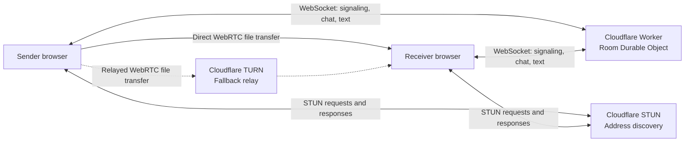

<p align="center">
  
</p>

# holo

Ephemeral file, text, and chat sharing. Create a room, share its code, and connect
without an account. Available in English, Spanish, French, Portuguese, German,
and Hindi.

## how it works

Holo sends files between browsers over an encrypted WebRTC data channel. The
browsers use [Cloudflare STUN][stun] to discover addresses for a direct connection.
WebRTC prefers a working direct path and can relay the encrypted file bytes
through [Cloudflare TURN][turn] when a direct connection is unavailable.

[stun]: https://developers.cloudflare.com/realtime/sfu/get-started/connection-patterns/#network-connectivity
[turn]: https://developers.cloudflare.com/realtime/turn/

The Cloudflare Worker manages room membership and carries WebRTC signaling,
chat, and shared text over WebSockets. During connection setup, it supplies
both STUN and TURN in the ICE configuration when TURN credentials are available.
It supplies a STUN-only configuration if TURN is disabled or credential
issuance fails. File bytes bypass the signaling Worker.



Transfers have independent progress and controls for each recipient. The sender
advances from receiver acknowledgments after checksum validation and writing.
Pause, resume, and reconnect recovery retain progress while both tabs remain
open. Refreshing or closing a tab ends that transfer session.

- Up to **3 GiB per file** on receivers that support saving directly to disk.
- **100 MiB total** for in-memory receiving on other browsers; remove saved
  transfers to free the budget.
- Receivers accept files before data starts. Large files open a save picker.
- Sending to several recipients uploads one copy per recipient.
- Rooms currently allow up to ten participants. No chat or file content is
  persisted by the signaling service.

## structure

```text
frontend/                       Next.js website and six locales
  components/room/              room WebSocket, chat, text, and transfer UI
    p2p/                        WebRTC, checksums, pause/resume, receive sinks
signaling/                      Cloudflare Worker and per-room Durable Objects
  src/                          protocol validation, membership, TURN credentials
  test/                         workerd integration tests
```

## running locally

Requires Bun and Node.js 24 or later.

```bash
bun install
cd signaling && bun install
cd ../frontend && bun install
```

Terminal 1, from the repository root:

```bash
cd signaling
bun run dev -- --port 8788 --var ORIGINS:http://localhost:3000 --var TURN_ENABLED:false
```

Terminal 2, from the repository root:

```bash
cd frontend
NEXT_PUBLIC_SIGNALING_URL=ws://localhost:8788/ws bun run dev
```

Open `http://localhost:3000` in two tabs. This setup uses STUN for direct
connections. To enable the TURN relay locally, change the Worker command to
use `--var TURN_ENABLED:true` and configure local credentials as described in
the [signaling setup](signaling/README.md).

For a hosted frontend, **set `NEXT_PUBLIC_SIGNALING_URL` at build time** to its
Cloudflare `wss://…/ws` endpoint.

## verification

```bash
bun run check                   # signaling + frontend checks
cd frontend && bun run test:e2e  # local Worker + real Chromium transfers
```

The browser suite covers three-person chat and file sharing, byte-exact
receiving, streaming above the memory limit to browser disk, and pause/reconnect
recovery. Install Chromium with `bunx playwright install chromium` if needed.
The disk test replaces the OS picker with a real browser file writer; the native
picker still needs a manual check. A full 3 GiB transfer is not yet benchmarked.

## deployment

Deploy a Cloudflare Worker with its own room namespace and include the
frontend's exact origin in the Worker's `ORIGINS` allowlist. For TURN relay
support, enable `TURN_ENABLED` and set `TURN_KEY_ID` and `TURN_API_TOKEN` as
Worker secrets. Set Vercel's production `NEXT_PUBLIC_SIGNALING_URL` to the
Worker's WebSocket endpoint before building the frontend.

Preview deployments use a separate Worker and room namespace. Point Vercel's
branch-specific Preview `NEXT_PUBLIC_SIGNALING_URL` at the preview Worker.

See [signaling setup](signaling/README.md), [client protocol](docs/p2p-client.md),
and [contributing](CONTRIBUTING.md).

## docker

Docker Compose runs the frontend only. Run or deploy the Cloudflare Worker
separately and provide the URL that the user's browser can reach:

```bash
NEXT_PUBLIC_SIGNALING_URL=wss://your-worker.workers.dev/ws docker compose up --build
```
